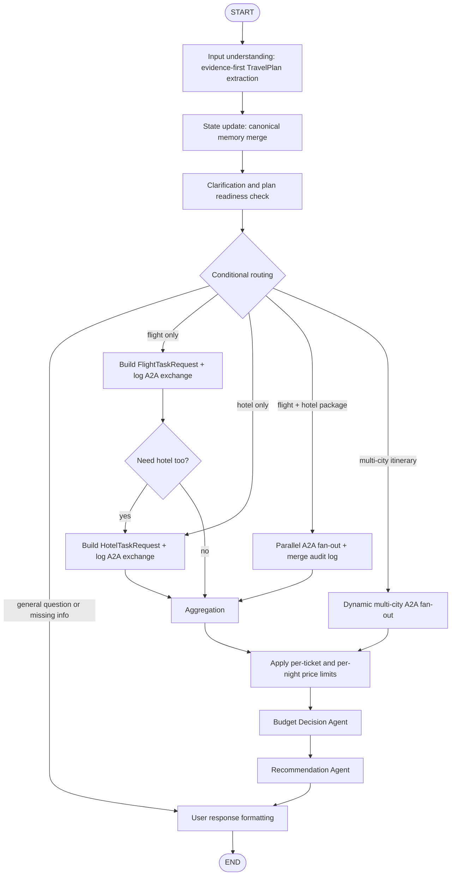
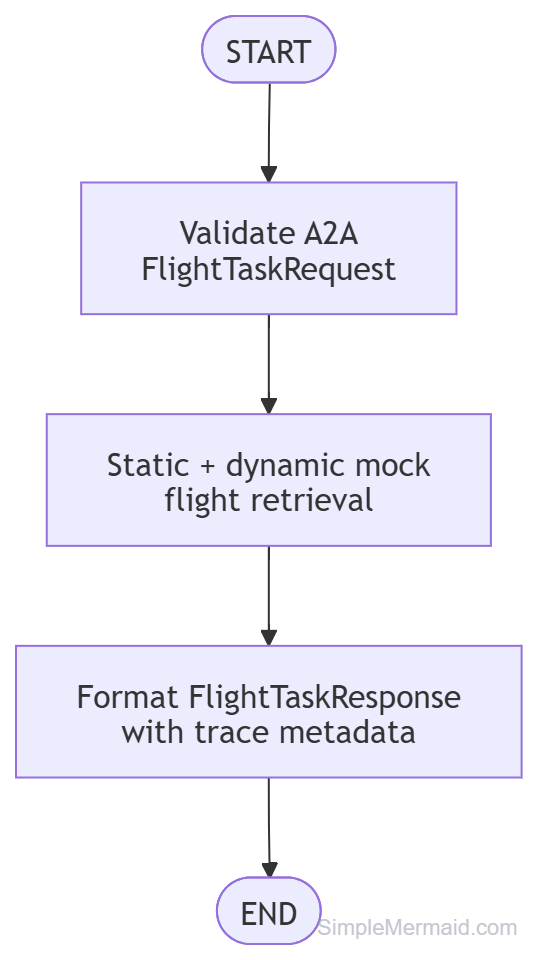
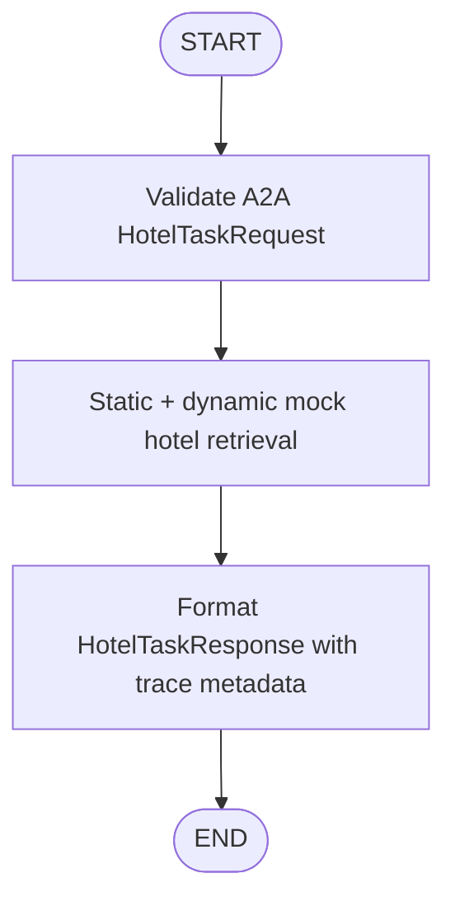
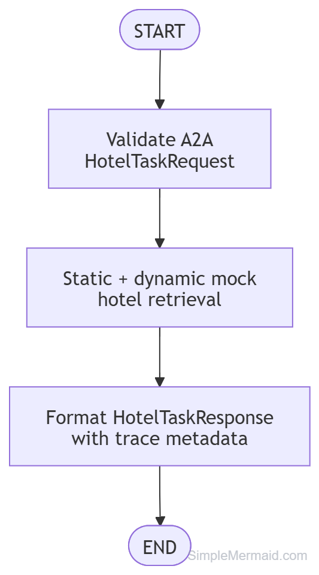

# SyncTrip - Friendly Assistant Agent

Your travel planner for mock flights, hotels, budget assessment, explained recommendations, and itinerary changes.

SyncTrip is a multi-agent mock travel booking assistant built with **Python 3.10+**, **LangGraph StateGraph**, strict typed **A2A task contracts**, mock flight/hotel data, Streamlit chat UI, deterministic tests, optional Ollama/Llama structured planning, and Mermaid/PNG graph visualisations.

The user interacts with one assistant only. Internally, the orchestrator maintains conversation memory, interprets natural-language travel requests, asks clarifying questions when required, and delegates to independent flight, hotel, budget, and recommendation agents through typed A2A request/response objects.

Full demo prompt:

```text
Book flight and hotel from Singapore to Tokyo on 2026-07-25 returning 2026-07-30 for 2 travellers, economy cabin, standard room near Shinjuku.
```

---

## 1. What this project demonstrates

This project is designed to satisfy the assignment rubric end-to-end:

| Rubric area | Implementation |
|---|---|
| A2A Protocol Implementation | Schema-first Pydantic request/response contracts, UUID task lifecycle, required fields retained, timezone-aware metadata timestamps, strict agent identities, forbidden unknown fields, status lifecycle validation, trace IDs, protocol version, and response result counts. |
| LangGraph Graph Design | Orchestrator, Flight, Hotel, Budget Decision, and Recommendation agents are separate `StateGraph` workflows. Conditional routing supports general response, flight-only, hotel-only, package, and multi-city paths. |
| Decision Intelligence | Per-leg and per-stay cost assessment, total-budget feasibility, and explainable budget / balanced / comfort recommendations after price filtering. |
| Orchestrator Intelligence | Evidence-first planner interprets natural-language travel prompts. Optional LLM planning helps with messy language, while deterministic validation protects against incomplete plans, impossible dates, stale state, and unsafe delegation. |
| Conversational UX | Friendly multi-turn chat, direct answers for general travel questions, no raw JSON/tracebacks exposed, readable flight/hotel sections, route interpretation shown for complex trips. |
| Code Quality & Tests | Modular agents, typed schemas, deterministic pytest mode, sub-agent isolation tests, orchestrator tests, planner regression tests, and required scenario coverage. |
| README & Documentation | Setup, run commands, architecture, A2A schema, LangGraph diagrams, required scenarios, and demo checklist. |
| Bonus Graph Visualisation | Mermaid diagrams in `graph_visualization/` plus graph helper methods in each agent wrapper. |

---

## 2. Repository structure

```text
/
├── orchestrator/
│   ├── agent.py              # SyncTrip/Friendly Assistant LangGraph orchestrator
│   ├── decision_support.py   # Option grouping, preferences, decision summaries
│   └── prompts.py            # LLM planning / clarification / response prompts
├── agents/
│   ├── decision_schemas.py   # Shared typed decision parameters and A2A contracts
│   ├── budget_agent/
│   │   └── agent.py          # Minimum trip cost and total-budget assessment graph
│   ├── recommendation_agent/
│   │   └── agent.py          # Explainable multi-criteria selection graph
│   ├── flight_agent/
│   │   ├── agent.py          # Flight Agent StateGraph
│   │   ├── mock_data.py      # Mock flight data and dynamic fallback routes
│   │   └── schemas.py        # Flight A2A request/response schemas
│   └── hotel_agent/
│       ├── agent.py          # Hotel Agent StateGraph
│       ├── mock_data.py      # Mock hotel inventory and dynamic destination options
│       └── schemas.py        # Hotel A2A request/response schemas
├── interface/
│   └── app.py                # Streamlit chat UI
├── graph_visualization/
│   ├── orchestrator_graph.mmd
│   ├── orchestrator_graph.png
│   ├── flight_agent_graph.mmd
│   ├── flight_agent_graph.png
│   ├── hotel_agent_graph.mmd
│   ├── hotel_agent_graph.png
│   ├── budget_agent_graph.mmd
│   └── recommendation_agent_graph.mmd
├── scripts/
│   ├── check_ollama.py
│   └── export_graphs.py
├── tests/
│   ├── test_flight_agent.py
│   ├── test_hotel_agent.py
│   ├── test_orchestrator.py
│   ├── test_decision_agents.py
│   ├── test_decision_integration.py
│   ├── test_planner_kernel_advanced.py
│   ├── test_llm_first_planner_regression.py
│   ├── test_required_assignment_scenarios.py
│   └── test_submission_readiness_matrix.py
├── requirements.txt
├── .env.example
└── README.md
```

---

## 3. Quick start

```powershell
python -m venv .venv
.\.venv\Scripts\activate
python -m pip install -r requirements.txt
copy .env.example .env
python -m pytest tests -q
streamlit run interface/app.py
```

Use `python -m pytest tests -q` rather than `pytest -q` on locked-down Windows laptops where `pytest.exe` may be blocked by Application Control. The separate `rpg_memory_system` has its own dependencies and test suite.

### Local memory demo

The Streamlit sidebar lets one local demo user save a home airport, cabin, room type, and separate flight-per-ticket / hotel-per-night price limits. After each chat turn, SyncTrip saves the active route and the latest eight conversation messages to `.synctrip/memory.json`, which is excluded from Git. Reopening the page restores the conversation and lets the assistant continue the active trip; fresh A2A requests receive a new session ID.

Use **Save plan to history** to record a planned trip with an optional decision and feedback. **Use saved route** starts a new draft from its route and asks for new dates. **Reset conversation** clears the active trip but keeps the profile and saved plans. **Clear all memory** removes the local file after you tick the confirmation box. These are mock plans, not bookings.

Priority is explicit current request, then active trip, then saved profile. A request such as `flight under $500 and hotel under $150 per night` overrides saved price limits for the active trip. If the mock search has no option inside a limit, the assistant says so instead of showing an over-budget option. A corrupt or unwritable memory file leaves chat available and is not automatically overwritten.

---

## 4. Optional Ollama / local Llama mode

The project runs without a cloud API key. Unit tests are deterministic and force heuristic mode from `tests/conftest.py`.

For the Streamlit demo, install/start Ollama and set `.env`:

```env
FRIENDLY_ASSISTANT_LLM_PROVIDER=ollama
FRIENDLY_ASSISTANT_DISABLE_LLM=false
OLLAMA_BASE_URL=http://localhost:11434
OLLAMA_MODEL=llama3.1:8b
```

Then restart Streamlit fully:

```powershell
Ctrl + C
streamlit run interface/app.py
```

The sidebar shows LLM diagnostics:

```json
{
  "provider": "ollama",
  "used": true,
  "called": true,
  "latency_ms": 1000,
  "error": null
}
```

---

## 5. Architecture

```text
User
→ Streamlit Chat UI
→ Friendly Assistant Orchestrator StateGraph
→ evidence-first TravelPlan extraction
→ optional LLM semantic proposal
→ canonical-plan validation and merge guardrails
→ clarification / routing decision
→ A2A Flight Agent and/or A2A Hotel Agent
→ aggregation
→ per-ticket / per-night budget filtering
→ A2A Budget Decision Agent: minimum complete-plan cost and feasibility
→ A2A Recommendation Agent: scored choices and total-budget priority
→ friendly response
```

The design separates responsibilities clearly:

- **Current-turn evidence**: explicit cities, dates, durations, and scope in the latest user message win over stale memory.
- **LLM**: understands messy language and proposes a structured travel plan when local Ollama is enabled.
- **Planner validation**: checks dates, routes, missing slots, scope, and stale state before any A2A task is created.
- **LangGraph**: manages stateful orchestration and routing.
- **A2A search agents**: execute typed flight/hotel searches.
- **A2A decision agents**: assess all required legs/stays and recommend an explained combination after price filtering.
- **A2A audit trail**: every request and response is stored in `a2a_messages` with task id, task type, direction, agent id, trace id, and serialized payload.
- **Mock data layer**: returns realistic options without live API calls.
- **Unsupported-location guard**: explicit travel locations outside the mock catalog return a clear no-data response before delegation.

The flight and hotel agents intentionally do not talk to the user. They only receive A2A tasks and return A2A responses.

---

## 6. Orchestrator StateGraph



Mermaid file: `graph_visualization/orchestrator_graph.mmd`

The Mermaid source above reflects the current five-workflow architecture. Existing PNG snapshots predate the decision agents; regenerate them with the commands in section 13 when PNG exports are needed.

The orchestrator state tracks the assignment-required items directly: `conversation_history`, `travel_params`, `pending_clarifications`, `flight_response`, `hotel_response`, `final_aggregated_options`, and the extended `a2a_messages` protocol audit log.

---

## 7. Flight Agent StateGraph


Mermaid file: `graph_visualization/flight_agent_graph.mmd`



Flight agent behavior:

- Accepts only typed A2A `flight_search` tasks from the orchestrator.
- Validates required fields before retrieval: origin, destination, departure date, optional return date, passengers, cabin class, and optional open-jaw return destination.
- Normalizes common city names/codes and cabin aliases, for example `Singapore` to `SIN` and `business class` to `business`.
- Handles one-way, round-trip, and open-jaw return searches.
- Uses static mock rows when present and deterministic route-aware synthetic options for supported city pairs when exact dates are not preloaded.
- Returns `needs_clarification`, `failed`, `partial`, or `success` through the A2A response schema only.

---

## 8. Hotel Agent StateGraph



Mermaid file: `graph_visualization/hotel_agent_graph.mmd`



Hotel agent behavior:

- Accepts only typed A2A `hotel_search` tasks from the orchestrator.
- Validates required fields before retrieval: destination, check-in date, check-out date, guests, room type, and optional location preference.
- Normalizes common destination names/codes and room aliases, for example `Mexico City` to `MEX` and `junior suite` to `suite`.
- Works with dates supplied directly by the user or derived by the orchestrator from flight dates and stay length.
- Uses static mock inventory when present and deterministic city-aware hotel generation for supported mock destinations.
- Returns field-specific clarification or structured hotel options through the A2A response schema only.

---

## 9. A2A contract

### Flight request

```json
{
  "task_id": "uuid-string",
  "task_type": "flight_search",
  "session_id": "uuid-string",
  "parameters": {
    "origin": "SIN",
    "destination": "TYO",
    "departure_date": "2025-06-15",
    "return_date": "2025-06-20",
    "return_destination": null,
    "passengers": 1,
    "cabin_class": "economy"
  },
  "metadata": {
    "requested_by": "orchestrator",
    "timestamp": "ISO-8601",
    "protocol_version": "a2a-mock-1.0",
    "sender_agent_id": "friendly-assistant-orchestrator",
    "receiver_agent_id": "flight-agent",
    "trace_id": "uuid-string"
  }
}
```

### Hotel request

```json
{
  "task_id": "uuid-string",
  "task_type": "hotel_search",
  "session_id": "uuid-string",
  "parameters": {
    "destination": "TYO",
    "check_in_date": "2025-06-15",
    "check_out_date": "2025-06-20",
    "guests": 1,
    "room_type": "standard",
    "location_preference": "Shinjuku"
  },
  "metadata": {
    "requested_by": "orchestrator",
    "timestamp": "ISO-8601",
    "protocol_version": "a2a-mock-1.0",
    "sender_agent_id": "friendly-assistant-orchestrator",
    "receiver_agent_id": "hotel-agent",
    "trace_id": "uuid-string"
  }
}
```

### Response lifecycle

Sub-agents always return:

```json
{
  "task_id": "uuid-string",
  "status": "success | partial | failed | needs_clarification",
  "results": [],
  "clarification_needed": null,
  "error": null,
  "metadata": {
    "agent_id": "flight-agent | hotel-agent | budget-agent | recommendation-agent",
    "timestamp": "ISO-8601",
    "protocol_version": "a2a-mock-1.0",
    "trace_id": "uuid-string",
    "result_count": 0,
    "warnings": []
  }
}
```

### Orchestrator A2A audit log

The orchestrator state keeps `a2a_messages`, a serializable audit trail of every sub-agent exchange:

```json
{
  "direction": "orchestrator_to_sub_agent | sub_agent_to_orchestrator",
  "node": "flight_delegation | hotel_delegation | multi_city_delegation",
  "agent_id": "flight-agent | hotel-agent",
  "task_id": "uuid-string",
  "task_type": "flight_search | hotel_search | budget_assessment | option_recommendation",
  "trace_id": "uuid-string",
  "payload": {}
}
```

The request and response for the same task share the same `trace_id`, while all required assignment fields remain present at the top level and in metadata.

Contract guardrails:

- Unknown request/response fields are rejected.
- `task_id`, `session_id`, `trace_id`, and optional `parent_task_id` are validated as UUID strings.
- Metadata timestamps must be valid ISO-8601 values with timezone information.
- Sender, receiver, responding agent, task type, and protocol version are constrained to the correct values.
- Response status and payload must agree: success requires results, partial requires results plus clarification, failed requires an error, and clarification responses cannot contain results.

---

## 10. Required assignment scenarios

| # | Required scenario | Verified behavior |
|---|---|---|
| 1 | Full details upfront | Delegates to both agents and returns combined flight + hotel results. |
| 2 | Only destination provided | Asks for dates, travellers, and booking scope. |
| 3 | Only flight details provided | Searches flights, then asks whether hotel options should be added. |
| 4 | Destination change mid-chat | Clears only destination/hotel-dependent state and re-delegates with the new destination. |
| 5 | No available flights | Returns a friendly no-availability message and suggestions, without raw internal errors. |
| 6 | Round-trip + hotel inferred | Uses flight departure/return dates as hotel check-in/check-out dates. |

The explicit tests are in `tests/test_required_assignment_scenarios.py` and the broader regression suite.

Supported dynamic mock destinations:

`Singapore`, `Tokyo`, `Paris`, `Dubai`, `London`, `Sydney`, `Bangkok`, `Hong Kong`, `Seoul`, `Kuala Lumpur`, `Bengaluru`, `Delhi`, `Mumbai`, `Bali`, `Zurich`, `Rome`, `Barcelona`, `San Francisco`, `Toronto`, `New York`, and `Mexico City`.

An explicit city outside this catalog returns: `I don't have mock data for <location>...` with supported-city suggestions. Reykjavik remains the deliberate no-availability route used to verify a structured `failed` Flight Agent response.

---

## 11. Demo script

Use these prompts as a flow during the walkthrough so the evaluator can see memory, edits, fresh-plan replacement, and safe non-travel handling.

### 1. Full package

```text
Book flight and hotel from Singapore to Tokyo on 2025-06-15 returning 2025-06-20 for 2 travellers near Shinjuku.
```

### 2. Assignment problem-statement prompt

```text
I'd like to fly from Singapore to Tokyo, arriving around the 15th of June, and I'll need a hotel for 5 nights near Shinjuku.
```

Because the wording says `arriving around` and does not include a traveller count, the safer assignment-demo behavior is to ask one clarification first:

```text
Use 2026-06-15 for 2 travellers.
```

The assistant then reuses the stored route, 5-night stay, and Shinjuku preference before delegating to both sub-agents.

### 3. Partial prompt

```text
Tokyo
```

Then answer the clarification:

```text
25 July 2026, 2 travellers, both flights and hotels, from Singapore, returning 2026-07-30
```

### 4. Multi-city memory flow

Turn 1:

```text
Plan Singapore to Tokyo to Paris to Singapore starting 2026-09-01, 5 days each city. Give flights and hotels.
```

Turn 2:

```text
change in plan replace Paris with BLR
```

### 5. General travel advice without delegation

```text
Which of these places is better for food and historical places?
```

### 6. Non-travel question is politely scoped

```text
tell me about calculus and how probability and statistics are needed to learn about AI
```

---

## 12. Testing

Run all tests:

```powershell
python -m pytest -q
```

Run specific areas:

```powershell
python -m pytest tests/test_required_assignment_scenarios.py -q
python -m pytest tests/test_flight_agent.py tests/test_hotel_agent.py -q
python -m pytest tests/test_orchestrator.py -q
```

Tests deliberately disable Ollama so the suite is repeatable on every machine. The Streamlit app can still use Ollama for live semantic planning.

The main application suite includes the assignment matrix, planner and memory regressions, independent decision-agent tests, and conversational decision integration tests.

---

## 13. Graph export

Mermaid sources for all five workflows are in `graph_visualization/`. Refresh them with:

```powershell
python scripts/export_graphs.py
```

To regenerate the PNG files, paste each `.mmd` file into Mermaid Live Editor or use Mermaid CLI:

```powershell
mmdc -i graph_visualization/orchestrator_graph.mmd -o graph_visualization/orchestrator_graph.png
mmdc -i graph_visualization/flight_agent_graph.mmd -o graph_visualization/flight_agent_graph.png
mmdc -i graph_visualization/hotel_agent_graph.mmd -o graph_visualization/hotel_agent_graph.png
mmdc -i graph_visualization/budget_agent_graph.mmd -o graph_visualization/budget_agent_graph.png
mmdc -i graph_visualization/recommendation_agent_graph.mmd -o graph_visualization/recommendation_agent_graph.png
```

---

## 14. Submission verification

- All six minimum viable scenarios have explicit tests.
- General travel questions route to the orchestrator response path without A2A delegation.
- Destination changes preserve reusable origin/passenger/date context while clearing destination-dependent results and hotel preferences.
- Round-trip flight dates are reused as hotel check-in/check-out dates.
- Fresh-plan language clears stale itinerary and traveller state.
- Unsupported explicit locations never reach the booking agents.
- Flight and Hotel Agent graphs run independently in unit tests.
- Exported Mermaid sources match the implemented graph nodes.
- No live API credentials are required for deterministic grading.

---

## 15. Design boundaries

- No live flight/hotel APIs are used; mock data only.
- The assistant does not claim real booking availability.
- Non-travel knowledge requests are politely declined instead of being forced into the travel planner.
- The LLM proposes structured plans, but typed validators control execution.
- Sub-agents are stateless by design and remain testable in isolation.

---

## 16. Decision agents

Two small, deterministic decision modules extend the existing search workflow. Neither needs Ollama or additional dependencies.

| Agent | Responsibility | Graph |
|---|---|---|
| `BudgetDecisionAgent` | Choose the minimum price in each required leg/stay, estimate combined costs, identify missing components, and report budget shortfall. | validate → assess budget → respond |
| `RecommendationAgent` | Score options, select one per group, respect the total budget when feasible, and explain each choice. | validate → score → apply total budget → respond |

### Try it

```text
Book flight and hotel from Singapore to Tokyo on 2027-07-25 returning 2027-07-30 for 2 travellers. Choose cheapest, total budget $3000.
```

Then change your decision preference without repeating the route:

```text
Prioritize comfort.
```

```text
Use a balanced plan, total budget of $3500.
```

These preferences also apply to multi-city trips. The active trip retains them; `New trip` resets the strategy to balanced and clears its total budget. Per-ticket and per-night limits still run first, with the existing current-request/profile priority.

### Scoring and budget behavior

`budget` always selects the cheapest option in each group, using quality scores to break price ties. `balanced` and `comfort` use normalized scores from 0 to 100:

| Strategy | Flight: price / duration / fewer stops | Hotel: price / stars / preferred area / refundable |
|---|---|---|
| balanced | 40% / 35% / 25% | 40% / 35% / 15% / 10% |
| comfort | 15% / 45% / 40% | 15% / 45% / 25% / 15% |

Price, duration, and hotel-star components are normalized within each group; fewer-stop benefit is `1 / (1 + stops)`. Preferred-area match and refundability are binary benefits. When there is no area preference, its component is equal for all hotels. Ties preserve the search order.

If preferred selections exceed the total budget, the agent falls back to the cheapest available combination and says why. If even that combination costs too much, it reports a closest mock plan and the exact shortfall. This deliberately simple fallback does not optimize all possible combinations under a budget.

Flight totals include **all passengers on every leg**. Hotel totals include **one room per night for every stay**, matching the current mock API; guest counts do not establish room capacity. Meals, local transport, and other expenses are excluded. Missing or filtered-out legs/stays produce a **partial subtotal**, never an affordable complete-plan claim.

Both agents accept typed JSON A2A requests and return correlated task/trace metadata. A single-city package now has four tasks (two search + two decision); the three-leg/two-stay demo has seven. General advice and clarification do not run the decision agents. Enable **Show LangGraph trace** in Streamlit to inspect their structured decisions.

Relevant files: [`agents/decision_schemas.py`](agents/decision_schemas.py), [`agents/budget_agent/agent.py`](agents/budget_agent/agent.py), [`agents/recommendation_agent/agent.py`](agents/recommendation_agent/agent.py), and [`orchestrator/decision_support.py`](orchestrator/decision_support.py).
