# RPG Memory System 数据实现层 Mermaid 流程图

这张图刻意落到数据实现层：Redis key、MySQL 表、embedding JSON、LLM 抽取结果、RAG 相似度计算和上下文组装都画在流程里。

```mermaid
flowchart TD
    %% =========================
    %% Style
    %% =========================
    classDef api fill:#e8f2ff,stroke:#2f6fab,stroke-width:1px,color:#111;
    classDef controller fill:#fff4df,stroke:#b87514,stroke-width:1px,color:#111;
    classDef redis fill:#ffe8e8,stroke:#c0392b,stroke-width:1px,color:#111;
    classDef mysql fill:#eaffea,stroke:#2e7d32,stroke-width:1px,color:#111;
    classDef llm fill:#f2e9ff,stroke:#6f42c1,stroke-width:1px,color:#111;
    classDef decision fill:#fffbe6,stroke:#c9a227,stroke-width:1px,color:#111;
    classDef result fill:#eeeeee,stroke:#666,stroke-width:1px,color:#111;

    %% =========================
    %% User/API Layer
    %% =========================
    UserMsg["用户/NPC 对话消息<br/>user_id, project_id, role, content"]:::result

    subgraph API["FastAPI API 层: src/server/api/api_layer/main.py"]
        InitAPI["POST /api/memory/initialize<br/>InitializeUserRequest"]:::api
        DialogueAPI["POST /api/memory/dialogue<br/>DialogueRequest"]:::api
        ContextAPI["POST /api/memory/context<br/>MemoryContextRequest"]:::api
        GenerateAPI["POST /api/memory/generate_response<br/>GenerateResponseRequest"]:::api
        ProcessAPI["POST /api/memory/process<br/>ProcessMemoryRequest"]:::api
    end

    %% =========================
    %% Redis Storage
    %% =========================
    subgraph Redis["Redis 数据层: models/redis_client.py"]
        ShortKey[("short_term:{user_id}:{project_id}<br/>value = dialogue_history JSON list<br/>TTL = 3600s")]:::redis
        CoreKey[("core_memory:{user_id}:{project_id}<br/>value = user_profile + core_events + core_reflections JSON")]:::redis
    end

    %% =========================
    %% MySQL Storage
    %% =========================
    subgraph MySQL["MySQL 数据层: models/mysql_database.py"]
        UserProfile[("Memory_user_profiles<br/>id, user_id, project_id<br/>profile_json JSON<br/>dialogue_count<br/>created_at, updated_at<br/>unique(user_id, project_id)")]:::mysql
        CoreEvents[("Memory_core_events<br/>id, user_id, project_id<br/>content TEXT<br/>created_at, updated_at")]:::mysql
        EntityEvents[("Memory_entity_events<br/>id, user_id, project_id<br/>content TEXT<br/>embedding JSON<br/>created_at, updated_at")]:::mysql
        CoreReflections[("Memory_core_reflections<br/>id, user_id, project_id<br/>content TEXT<br/>created_at, updated_at")]:::mysql
        LongReflections[("Memory_long_term_reflections<br/>id, user_id, project_id<br/>content TEXT<br/>embedding JSON<br/>created_at, updated_at")]:::mysql
        NpcStories[("Memory_npc_stories<br/>id, story_name<br/>content TEXT<br/>embedding JSON")]:::mysql
        DialogueLogs[("Memory_dialogue_logs<br/>id, user_id, project_id<br/>role, content TEXT<br/>embedding JSON<br/>created_at")]:::mysql
    end

    %% =========================
    %% Controllers
    %% =========================
    subgraph Manager["MemoryManager: controllers/memory_manager.py"]
        InitManager["initialize_user_memory()<br/>创建/读取用户画像<br/>初始化 Redis 短期记忆和核心记忆"]:::controller
        AddDialogue["add_dialogue()<br/>读 short_term key<br/>append 新消息<br/>截断到 SHORT_TERM_MEMORY_SIZE<br/>写回 short_term key"]:::controller
        NeedProcess{"len(dialogue_history) >= MEMORY_THRESHOLD ?<br/>默认 60"}:::decision
        ProcessManager["process_memory()<br/>读取短期记忆<br/>查询 UserProfile<br/>dialogue_count += 本批对话数"]:::controller
        UpdateCoreCache["_update_core_memory()<br/>从 MySQL 汇总画像、最近核心事件、最近核心反思<br/>写入 core_memory key"]:::controller
        GetContext["get_memory_context()<br/>组装完整记忆上下文<br/>短期 Redis + 核心 Redis + 长期 RAG"]:::controller
    end

    subgraph Processor["MemoryProcessor: controllers/memory_processor.py"]
        Pipeline["process_memory_pipeline()<br/>asyncio.gather 并行 LLM 抽取<br/>整体超时 PIPELINE_TIMEOUT = 20s"]:::controller
        StoreMemory["_store_memory()<br/>合并画像<br/>生成长期记忆 embedding<br/>写入 MySQL"]:::controller
        ConsolidateCheck{"dialogue_count >= MEMORY_CONSOLIDATION_TRIGGER_ROUNDS ?<br/>默认 240"}:::decision
        Consolidate["consolidate_core_memories()<br/>核心事件/核心反思超过 limit=20 时<br/>LLM 合并、去重、精简<br/>delete old + insert new"]:::controller
    end

    subgraph LLM["LLMClient: models/llm_client.py"]
        ExtractProfile["extract_user_profile(dialogue_history)<br/>输出 profile_json 字段"]:::llm
        ExtractEvents["extract_events(dialogue_history)<br/>输出 core_events[] + entity_events[]"]:::llm
        GenerateReflection["generate_reflection(dialogue_history)<br/>输出 core_reflections[] + long_term_reflections[]"]:::llm
        Embedding["generate_embedding(text)<br/>输出 List[float]<br/>落库为 JSON"]:::llm
        ConsolidateLLM["consolidate_memories(memories, type)<br/>输出 consolidated_memories[]"]:::llm
        GenerateNPC["generate_npc_response(user_message, short_term, memory_context)<br/>使用核心记忆 + 长期检索结果生成回复"]:::llm
    end

    subgraph RAG["RAGRetriever: controllers/rag_retriever.py"]
        QueryEmbedding["query -> generate_embedding(query)<br/>得到 query_embedding"]:::llm
        ParallelRetrieval["asyncio.gather 并行 4 路检索<br/>return_exceptions=True<br/>某一路失败返回空列表"]:::controller
        Cosine["Python 内存中计算余弦相似度<br/>dot(vec1, vec2) / (norm1 * norm2)<br/>结果裁剪到 [0, 1]"]:::controller
        EntityRetrieval["_retrieve_entity_events()<br/>SELECT by user_id, project_id<br/>embedding IS NOT NULL<br/>parse JSON -> cosine -> sort -> top_k"]:::controller
        DialogueRetrieval["_retrieve_dialogue_logs()<br/>SELECT by user_id, project_id<br/>按相似度找 top 3 anchor"]:::controller
        DialogueWindow["_get_context_dialogue_groups()<br/>每个 anchor 取上 4 条 + anchor + 下 5 条<br/>UNION ALL 后按 id ASC 返回上下文组"]:::controller
        ReflectionRetrieval["_retrieve_long_term_reflections()<br/>SELECT by user_id, project_id<br/>parse JSON -> cosine -> sort -> top_k"]:::controller
        StoryRetrieval["_retrieve_npc_stories()<br/>全局 NPC 故事<br/>parse JSON -> cosine -> sort -> top_k"]:::controller
        LongTermResult["long_term_memory_retrieval<br/>entity_events[]<br/>dialogue_logs[]<br/>long_term_reflections[]<br/>npc_stories[]"]:::result
    end

    ContextResult["完整 memory_context 返回<br/>short_term_memory<br/>core_memory<br/>long_term_memory_retrieval"]:::result
    NPCReply["npc_response<br/>随后以 role='assistant' 写回短期记忆"]:::result

    %% =========================
    %% Initialize Flow
    %% =========================
    InitAPI --> InitManager
    InitManager -->|"不存在则 INSERT 初始 profile_json"| UserProfile
    InitManager -->|"store_short_term_memory([])"| ShortKey
    InitManager -->|"store_core_memory({user_profile,last_updated})"| CoreKey

    %% =========================
    %% Dialogue Write Flow
    %% =========================
    UserMsg --> DialogueAPI
    DialogueAPI --> AddDialogue
    AddDialogue -->|"get_short_term_memory()"| ShortKey
    ShortKey -->|"dialogue_history list"| AddDialogue
    AddDialogue -->|"append {role,content,timestamp}<br/>setex 3600s"| ShortKey
    AddDialogue --> NeedProcess
    NeedProcess -->|"否: 只返回 dialogue_count"| ContextResult
    NeedProcess -->|"是: 自动触发 process_memory()"| ProcessManager
    ProcessAPI --> ProcessManager

    %% =========================
    %% Memory Processing Flow
    %% =========================
    ProcessManager -->|"读取本批 dialogue_history"| ShortKey
    ProcessManager -->|"SELECT profile by user_id, project_id"| UserProfile
    ProcessManager -->|"dialogue_count += len(dialogue_history)"| UserProfile
    ProcessManager --> Pipeline

    Pipeline --> ExtractProfile
    Pipeline --> ExtractEvents
    Pipeline --> GenerateReflection

    ExtractProfile -->|"profile_json dict"| StoreMemory
    ExtractEvents -->|"core_events[]"| StoreMemory
    ExtractEvents -->|"entity_events[]"| StoreMemory
    GenerateReflection -->|"core_reflections[]"| StoreMemory
    GenerateReflection -->|"long_term_reflections[]"| StoreMemory

    StoreMemory -->|"merge old profile_json + new profile_json"| UserProfile
    StoreMemory -->|"去重后 INSERT content"| CoreEvents
    StoreMemory -->|"去重后 INSERT content"| CoreReflections

    StoreMemory -->|"entity_events[] each text"| Embedding
    Embedding -->|"embedding JSON"| EntityEvents

    StoreMemory -->|"long_term_reflections[] each text"| Embedding
    Embedding -->|"embedding JSON"| LongReflections

    StoreMemory -->|"dialogue_history each role:content"| Embedding
    Embedding -->|"embedding JSON + role/content"| DialogueLogs

    StoreMemory -->|"db.commit()"| UpdateCoreCache
    UpdateCoreCache -->|"SELECT UserProfile.profile_json"| UserProfile
    UpdateCoreCache -->|"SELECT recent 10 CoreEvent.content"| CoreEvents
    UpdateCoreCache -->|"SELECT recent 10 CoreReflection.content"| CoreReflections
    UpdateCoreCache -->|"store_core_memory()"| CoreKey
    UpdateCoreCache -->|"clear_short_term_memory()"| ShortKey

    ProcessManager --> ConsolidateCheck
    ConsolidateCheck -->|"否"| ContextResult
    ConsolidateCheck -->|"是"| Consolidate
    Consolidate -->|"读取全部核心事件 content"| CoreEvents
    Consolidate -->|"读取全部核心反思 content"| CoreReflections
    Consolidate --> ConsolidateLLM
    ConsolidateLLM -->|"delete old + insert consolidated"| CoreEvents
    ConsolidateLLM -->|"delete old + insert consolidated"| CoreReflections
    Consolidate -->|"成功后 dialogue_count = 0"| UserProfile
    Consolidate --> UpdateCoreCache

    %% =========================
    %% Context/RAG Read Flow
    %% =========================
    UserMsg --> ContextAPI
    UserMsg --> GenerateAPI
    ContextAPI --> GetContext
    GenerateAPI --> GetContext

    GetContext -->|"get_short_term_memory()"| ShortKey
    GetContext -->|"get_core_memory()"| CoreKey
    GetContext -->|"retrieve_long_term_memory(query,user_id,project_id)"| QueryEmbedding

    QueryEmbedding --> ParallelRetrieval

    ParallelRetrieval --> EntityRetrieval
    EntityRetrieval -->|"SELECT id,content,created_at,embedding"| EntityEvents
    EntityEvents -->|"embedding JSON candidates"| Cosine

    ParallelRetrieval --> DialogueRetrieval
    DialogueRetrieval -->|"SELECT id,role,content,created_at,embedding"| DialogueLogs
    DialogueLogs -->|"embedding JSON candidates"| Cosine
    DialogueRetrieval --> DialogueWindow
    DialogueWindow -->|"SELECT before/anchor/after by id"| DialogueLogs

    ParallelRetrieval --> ReflectionRetrieval
    ReflectionRetrieval -->|"SELECT id,content,created_at,embedding"| LongReflections
    LongReflections -->|"embedding JSON candidates"| Cosine

    ParallelRetrieval --> StoryRetrieval
    StoryRetrieval -->|"SELECT id,story_name,content,embedding"| NpcStories
    NpcStories -->|"embedding JSON candidates"| Cosine

    Cosine -->|"sort desc + top_k"| LongTermResult
    DialogueWindow -->|"context dialogue groups"| LongTermResult
    LongTermResult --> GetContext
    ShortKey -->|"short_term_memory"| GetContext
    CoreKey -->|"core_memory"| GetContext
    GetContext --> ContextResult

    %% =========================
    %% Generate Response Flow
    %% =========================
    ContextResult -->|"core_memory + long_term_memory_retrieval<br/>short_term_memory as dialogue_history"| GenerateNPC
    GenerateNPC --> NPCReply
    NPCReply -->|"memory_manager.add_dialogue(role='assistant', content=npc_response)"| AddDialogue
```

## 读图重点

- `short_term:{user_id}:{project_id}` 是短期对话缓存，保存最近消息列表，1 小时过期。
- `core_memory:{user_id}:{project_id}` 是核心记忆缓存，由 MySQL 中的用户画像、核心事件、核心反思重新聚合而来。
- 核心记忆表没有 embedding，因为它们生成回复时直接注入，不走相似度检索。
- 长期记忆表有 embedding JSON，包括实体事件、长期反思、历史对话、NPC 故事。
- 当前 RAG 不是数据库向量索引，而是 MySQL 查出候选 embedding 后，在 Python 中计算余弦相似度。
- 历史对话检索不是只返回单条命中，而是命中 anchor 后再取上 4 条和下 5 条，形成上下文组。
- `generate_response` 会先读取完整 memory_context，再生成 NPC 回复，最后把 assistant 回复重新写入短期记忆。

