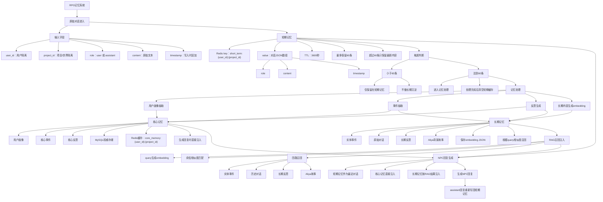

# RPG Memory System 实现细节树状图

这份文档把原来的发散式思维导图改成树状 Mermaid 图。每张图只展开一个主题，方便顺着层级看清楚“数据从哪里来、怎么处理、存到哪里、怎么召回、怎么注入”。

## 1. 总体数据流树

## 2. 记忆处理细节树

```mermaid
flowchart TB
    A["记忆处理"]

    A --> B["处理输入"]
    B --> B1["一批短期对话"]
    B --> B2["通常最多60条"]
    B --> B3["按 role: content 拼接为对话文本"]

    A --> C["并行LLM处理"]
    C --> C1["用户画像抽取"]
    C --> C2["事件抽取"]
    C --> C3["反思生成"]
    C --> C4["总超时20秒"]
    C --> C5["单路失败不影响其他成功结果"]

    C1 --> D["用户画像字段"]
    D --> D1["personal_info：姓名、年龄、性别、家乡、职业、教育背景"]
    D --> D2["personality：开朗、内向、乐观、谨慎等性格"]
    D --> D3["interests：运动、音乐、阅读、游戏、旅行等兴趣"]
    D --> D4["behavior_patterns：作息、沟通方式、决策风格"]
    D --> D5["preferences：颜色、食物、风格、品牌等偏好"]
    D --> D6["social_relationships：家人、朋友、同事等关系"]
    D --> D7["life_experiences：重大事件、成就、挫折"]
    D --> D8["values_beliefs：人生观、世界观、信仰"]
    D --> D9["skills_abilities：专业技能、语言能力、特长"]
    D --> D10["other_traits：习惯、癖好、特殊标记"]
    D --> D11["输出要求：JSON"]
    D --> D12["未提到的信息置为空数组或空字符串"]
    D --> D13["温度：0.3"]
    D --> D14["存储：写入profile_json，并与旧画像浅层合并"]

    C2 --> E["事件抽取结果"]
    E --> E1["核心事件"]
    E1 --> E11["剧情高度相关"]
    E1 --> E12["玩家重大选择"]
    E1 --> E13["影响深远"]
    E1 --> E14["每批最多3到5条"]
    E1 --> E15["一句话概括"]
    E1 --> E16["完全重复内容不再插入"]
    E1 --> E17["不生成embedding"]
    E1 --> E18["生成回复时直接注入"]
    E --> E2["实体事件"]
    E2 --> E21["日常互动"]
    E2 --> E22["具体实体信息"]
    E2 --> E23["较小事件"]
    E2 --> E24["每批最多3到5条"]
    E2 --> E25["一句话概括"]
    E2 --> E26["生成embedding"]
    E2 --> E27["作为长期记忆通过RAG召回"]
    E --> E3["温度：0.3"]
    E --> E4["输出要求：JSON"]

    C3 --> F["反思生成结果"]
    F --> F1["核心反思"]
    F1 --> F11["重大事件相关"]
    F1 --> F12["深层行为模式"]
    F1 --> F13["关键转变或重大决策"]
    F1 --> F14["完全重复内容不再插入"]
    F1 --> F15["不生成embedding"]
    F1 --> F16["生成回复时直接注入"]
    F --> F2["长期反思"]
    F2 --> F21["日常互动总结"]
    F2 --> F22["玩家偏好"]
    F2 --> F23["玩家习惯"]
    F2 --> F24["普通行为模式"]
    F2 --> F25["生成embedding"]
    F2 --> F26["作为长期记忆通过RAG召回"]
    F --> F3["角色视角：Aliya口吻"]
    F --> F4["约束：基于真实对话，不夸大不编造"]
    F --> F5["温度：0.7"]
    F --> F6["输出要求：JSON"]

    A --> G["embedding处理"]
    G --> G1["实体事件生成embedding"]
    G --> G2["长期反思生成embedding"]
    G --> G3["每条原始对话生成embedding"]
    G --> G4["embedding保存为MySQL JSON数组"]
    G --> G5["embedding失败则该条召回能力下降"]
```

## 3. 存储与索引设计树

```mermaid
flowchart TB
    A["MySQL存储设计"]

    A --> B["用户画像表"]
    B --> B1["用途：存结构化画像和处理计数"]
    B --> B2["字段"]
    B2 --> B21["id：自增主键"]
    B2 --> B22["user_id"]
    B2 --> B23["project_id"]
    B2 --> B24["profile_json：JSON"]
    B2 --> B25["dialogue_count：累计处理对话数"]
    B2 --> B26["created_at / updated_at"]
    B --> B3["索引"]
    B3 --> B31["user_id索引"]
    B3 --> B32["project_id索引"]
    B3 --> B33["user_id + project_id联合索引"]
    B3 --> B34["ORM层有 user_id + project_id 唯一约束"]

    A --> C["核心事件表"]
    C --> C1["用途：存重大事件，直接注入"]
    C --> C2["字段：id、user_id、project_id、content、created_at、updated_at"]
    C --> C3["索引：user_id、project_id、user_id + project_id"]
    C --> C4["无embedding"]

    A --> D["实体事件表"]
    D --> D1["用途：存普通事件，RAG召回"]
    D --> D2["字段：id、user_id、project_id、content、embedding、created_at、updated_at"]
    D --> D3["embedding：JSON浮点数组"]
    D --> D4["索引：user_id、project_id、user_id + project_id"]

    A --> E["核心反思表"]
    E --> E1["用途：存重大反思，直接注入"]
    E --> E2["字段：id、user_id、project_id、content、created_at、updated_at"]
    E --> E3["索引：user_id、project_id、user_id + project_id"]
    E --> E4["无embedding"]

    A --> F["长期反思表"]
    F --> F1["用途：存普通反思，RAG召回"]
    F --> F2["字段：id、user_id、project_id、content、embedding、created_at、updated_at"]
    F --> F3["embedding：JSON浮点数组"]
    F --> F4["索引：user_id、project_id、user_id + project_id"]

    A --> G["NPC故事表"]
    G --> G1["用途：存Aliya背景故事chunk，全局召回"]
    G --> G2["字段：id、story_name、content、embedding"]
    G --> G3["embedding：JSON浮点数组"]
    G --> G4["索引：story_name"]
    G --> G5["不按user_id隔离"]

    A --> H["原始对话表"]
    H --> H1["用途：保存完整历史消息，支持上下文召回"]
    H --> H2["字段：id、user_id、project_id、role、content、embedding、created_at"]
    H --> H3["embedding：JSON浮点数组"]
    H --> H4["索引"]
    H4 --> H41["user_id索引"]
    H4 --> H42["project_id索引"]
    H4 --> H43["user_id + project_id联合索引"]
    H4 --> H44["role索引"]
    H4 --> H45["created_at索引"]

    A --> I["Redis缓存设计"]
    I --> I1["短期记忆key：short_term:{user_id}:{project_id}"]
    I --> I2["核心记忆key：core_memory:{user_id}:{project_id}"]
    I --> I3["短期记忆有TTL"]
    I --> I4["核心记忆作为MySQL聚合后的快速读取副本"]
```

## 4. 核心记忆与长期记忆关系树

```mermaid
flowchart TB
    A["记忆分层"]

    A --> B["核心记忆"]
    B --> B1["用户画像"]
    B1 --> B11["profile_json结构化保存"]
    B1 --> B12["生成回复时完整注入"]
    B --> B2["核心事件"]
    B2 --> B21["重大剧情或玩家关键选择"]
    B2 --> B22["不走RAG"]
    B2 --> B23["最近10条写入核心缓存"]
    B --> B3["核心反思"]
    B3 --> B31["重大事件相关的角色反思"]
    B3 --> B32["不走RAG"]
    B3 --> B33["最近10条写入核心缓存"]
    B --> B4["为什么直接注入"]
    B4 --> B41["避免关键事实因相似度低被漏掉"]
    B4 --> B42["保证NPC长期一致性"]
    B --> B5["膨胀控制"]
    B5 --> B51["累计处理对话达到240条后检查"]
    B5 --> B52["核心事件超过20条时整合"]
    B5 --> B53["核心反思超过20条时整合"]
    B5 --> B54["合并相似项"]
    B5 --> B55["删除冗余项"]
    B5 --> B56["精简表达"]
    B5 --> B57["保留最重要内容"]

    A --> C["长期记忆"]
    C --> C1["实体事件"]
    C1 --> C11["普通事实和日常事件"]
    C1 --> C12["有embedding"]
    C1 --> C13["按query召回"]
    C --> C2["原始对话"]
    C2 --> C21["完整保存历史消息"]
    C2 --> C22["有role和content"]
    C2 --> C23["有embedding"]
    C2 --> C24["召回时带上下文窗口"]
    C --> C3["长期反思"]
    C3 --> C31["普通偏好和习惯总结"]
    C3 --> C32["有embedding"]
    C3 --> C33["按query召回"]
    C --> C4["Aliya背景故事"]
    C4 --> C41["来自Markdown切分"]
    C4 --> C42["全局NPC资料"]
    C4 --> C43["有embedding"]
    C4 --> C44["按query召回"]
    C --> C5["为什么RAG注入"]
    C5 --> C51["长期内容数量大"]
    C5 --> C52["不能全部塞进prompt"]
    C5 --> C53["只取与当前问题相关的片段"]
```

## 5. RAG召回实现树

```mermaid
flowchart TB
    A["RAG召回"]

    A --> B["查询向量"]
    B --> B1["当前用户消息作为query"]
    B --> B2["生成query embedding"]

    A --> C["相似度方法"]
    C --> C1["余弦相似度"]
    C1 --> C11["点积"]
    C1 --> C12["除以两个向量模长"]
    C1 --> C13["向量为空则相似度为0"]
    C1 --> C14["结果限制在0到1"]

    A --> D["四路并行召回"]
    D --> D1["实体事件召回"]
    D1 --> D11["按user_id和project_id过滤"]
    D1 --> D12["要求embedding不为空"]
    D1 --> D13["解析JSON向量"]
    D1 --> D14["逐条计算余弦相似度"]
    D1 --> D15["按相似度降序"]
    D1 --> D16["返回top_k，默认10"]

    D --> D2["原始对话召回"]
    D2 --> D21["按user_id和project_id过滤"]
    D2 --> D22["要求embedding不为空"]
    D2 --> D23["先计算每条消息相似度"]
    D2 --> D24["选最相关3条作为anchor"]
    D2 --> D25["每个anchor向前取4条"]
    D2 --> D26["每个anchor向后取5条"]
    D2 --> D27["每组最多10条"]
    D2 --> D28["按id升序恢复对话顺序"]
    D2 --> D29["目的：避免只召回单句造成上下文断裂"]

    D --> D3["长期反思召回"]
    D3 --> D31["按user_id和project_id过滤"]
    D3 --> D32["要求embedding不为空"]
    D3 --> D33["解析JSON向量"]
    D3 --> D34["逐条计算余弦相似度"]
    D3 --> D35["按相似度降序"]
    D3 --> D36["返回top_k，默认10"]

    D --> D4["Aliya故事召回"]
    D4 --> D41["查询全局故事库"]
    D4 --> D42["不按user_id过滤"]
    D4 --> D43["要求embedding不为空"]
    D4 --> D44["解析JSON向量"]
    D4 --> D45["逐条计算余弦相似度"]
    D4 --> D46["按相似度降序"]
    D4 --> D47["返回top_k，默认10"]

    A --> E["注入数量"]
    E --> E1["NPC回复生成时"]
    E1 --> E11["实体事件最多3条"]
    E1 --> E12["历史对话最多3条"]
    E1 --> E13["长期反思最多3条"]
    E1 --> E14["Aliya故事最多2条"]
    E --> E2["直接获取格式化上下文时"]
    E2 --> E21["实体事件最多10条"]
    E2 --> E22["历史对话最多3组"]
    E2 --> E23["长期反思最多8条"]
    E2 --> E24["Aliya故事最多2条"]

    A --> F["当前实现取舍"]
    F --> F1["embedding存MySQL JSON"]
    F --> F2["没有数据库向量索引"]
    F --> F3["候选向量取出后在Python内存计算"]
    F --> F4["优点：实现简单、方便调试"]
    F --> F5["缺点：数据量大时性能下降"]
```

## 6. Aliya背景故事切分与召回树

```mermaid
flowchart TB
    A["Aliya背景故事"]

    A --> B["数据来源"]
    B --> B1["Aliya长期记忆Markdown"]
    B --> B2["初始化时读取整个文件"]

    A --> C["文本清洗"]
    C --> C1["去除HTML标签"]
    C --> C2["去除Markdown加粗标记"]
    C --> C3["去除星号斜体标记"]
    C --> C4["去除首尾空白"]

    A --> D["标题切分"]
    D --> D1["二级标题"]
    D1 --> D11["作为大主题"]
    D1 --> D12["遇到新二级标题保存上一块"]
    D --> D2["三级标题"]
    D2 --> D21["与当前二级标题组合"]
    D2 --> D22["形成更具体story_name"]
    D --> D3["四级标题"]
    D3 --> D31["与上级标题组合"]
    D3 --> D32["形成细粒度chunk标题"]
    D --> D4["加粗项目"]
    D4 --> D41["支持加号加粗"]
    D4 --> D42["支持减号加粗"]
    D4 --> D43["支持数字编号加粗"]
    D4 --> D44["提取加粗文字作为标题部分"]

    A --> E["列表项切分"]
    E --> E1["长列表项可单独成块"]
    E --> E2["列表项长度大于60字符时独立保存"]
    E --> E3["短列表项并入当前块"]
    E --> E4["会收集缩进子项"]

    A --> F["chunk过滤"]
    F --> F1["四级或加粗项目块超过80字符才立即保存"]
    F --> F2["最终导入前保留content长度大于20字符的块"]

    A --> G["入库结构"]
    G --> G1["story_name：标题路径或列表关键词"]
    G --> G2["content：清洗后的chunk正文"]
    G --> G3["embedding：对content生成向量"]

    A --> H["初始化控制"]
    H --> H1["故事表已有数据时默认跳过"]
    H --> H2["强制重建时先删除旧故事"]
    H --> H3["再重新切分、向量化、入库"]

    A --> I["召回方式"]
    I --> I1["用户当前query生成向量"]
    I --> I2["与每个故事chunk向量计算余弦相似度"]
    I --> I3["按相似度降序"]
    I --> I4["检索阶段默认返回10条"]
    I --> I5["回复注入通常使用前2条"]
```

## 7. NPC回复组装树

```mermaid
flowchart TB
    A["NPC回复上下文"]

    A --> B["短期记忆"]
    B --> B1["最近对话历史"]
    B --> B2["保留role和content"]
    B --> B3["作为对话连贯性基础"]

    A --> C["核心记忆"]
    C --> C1["用户画像"]
    C --> C2["核心事件"]
    C --> C3["核心反思"]
    C --> C4["直接注入"]

    A --> D["长期记忆"]
    D --> D1["相关实体事件"]
    D --> D2["相关历史对话"]
    D --> D3["相关长期反思"]
    D --> D4["相关Aliya故事"]
    D --> D5["带相似度分数"]
    D --> D6["按RAG结果筛选后注入"]

    A --> E["回复约束"]
    E --> E1["自然友好"]
    E --> E2["基于记忆做个性化回复"]
    E --> E3["保持对话连贯"]
    E --> E4["长度适中"]
    E --> E5["信息不足时询问更多信息"]

    A --> F["回复回写"]
    F --> F1["生成NPC回复"]
    F --> F2["作为assistant消息"]
    F --> F3["写回短期记忆"]
    F --> F4["参与后续60条一批的记忆沉淀"]
```

